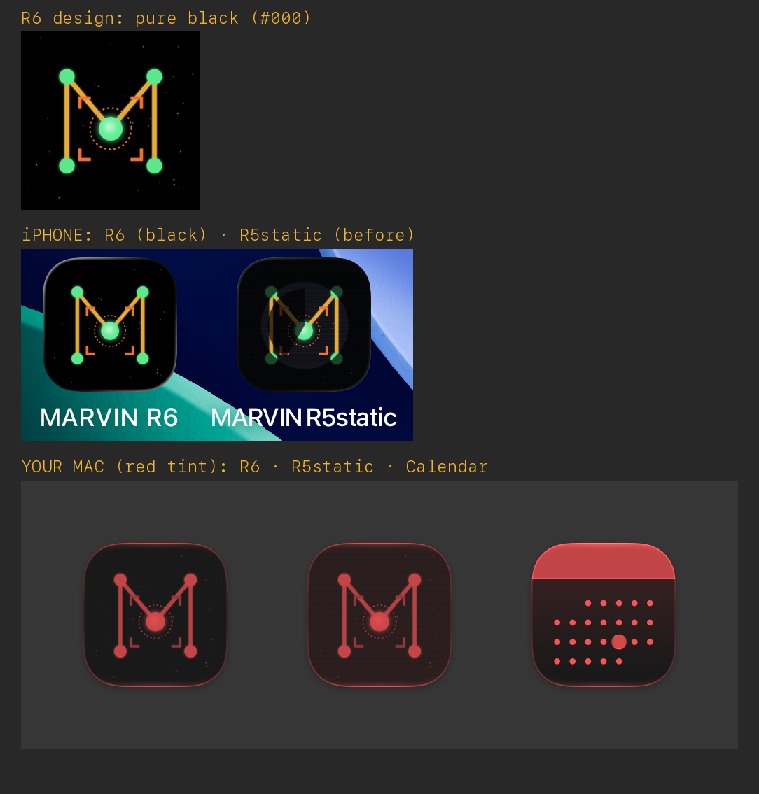
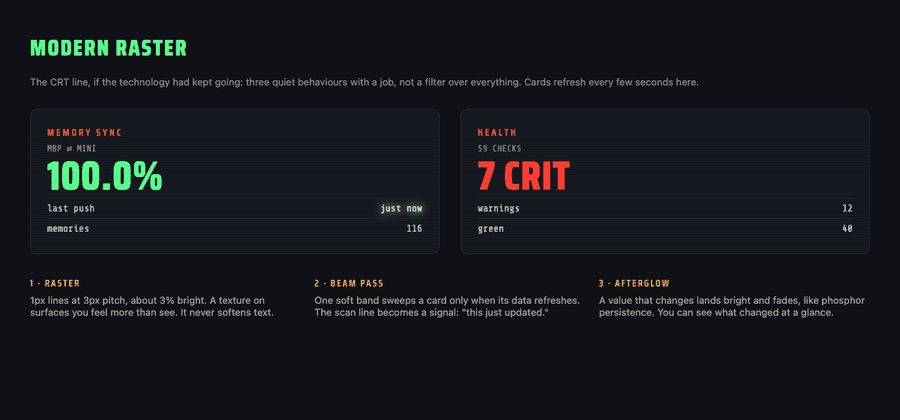
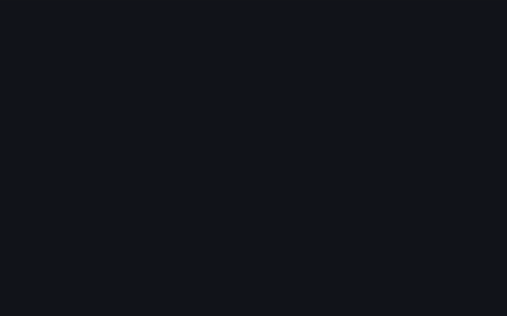
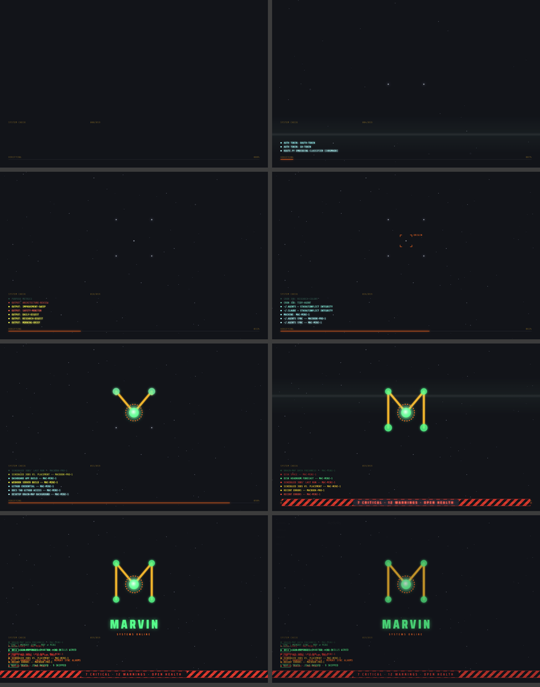

# Celestial navigation: MARVIN's visual identity

**Status: in progress, not approved.** The icon and the boot sequence are the first pieces. The dashboard UI redo
must use this same theme when it happens, so treat these tokens as the shared source of truth and don't fork them.

## The idea

MARVIN keeps no memory inside the model. It is rebuilt each session from linked notes: memories, handoffs, the lexicon.
A constellation works the same way: separate points that only mean something once they are connected. People also used
constellations as one of the first external memories, to keep stories and to find their way home.

- **Philosophy is the core.** The design rule is elegant sufficiency (Watts / Colton). A star chart exists to get you
  somewhere, not to admire itself.
- **The look is retro.** Apollo-era mission control: phosphor green, amber hairlines, the terminal MARVIN was born in.
- **The tone is sci-fi, in the Evangelion/NERV style.** Hard-edged HUD panels, hazard stripes, target locks, a
  sync-ratio readout and a CRT power-on. It's hopeful exploration, not surveillance: no eyes, nothing watching.

Reference for the palette and HUD language: https://sentry.artificialisabel.com/

## Tokens

| Token | Value | Use |
|---|---|---|
| `--bg` | `#05040A` | background |
| `--green` | `#54ff8a` | phosphor: stars, primary readouts, "ok" |
| `--amber` | `#f0b32a` | constellation lines, body text |
| `--line` | `#7a5a14` | hairline panel borders |
| `--orange` | `#ff6a1f` | locks, orbits, hazard stripes, in-progress states |
| `--red` | `#ff3b2f` | tags, warnings |
| `--dim` | `#6b551f` | secondary labels |
| `--moon` | `#cfd6e6` | background stars |

Fonts: **Saira Condensed** (600/800) for display and tags, **Share Tech Mono** for data and logs.
Recurring details: scanlines, diamond nodes on panel edges, a faint hex grid toward the edges, red-outlined tags.

## The mark

There are five stars in an M. The centre star (`core`) is MARVIN. It glows brightest and has a dashed orange orbit.
The geometry lives in one `ICON` object (1024 grid), which both `icon.html` and `boot.html` read, so changing the
icon changes the boot as well.

- App icons carry **no words or text**. That was tested on the real devices: text disappears at icon size.
- The icon must survive macOS **tinted icon mode**. Gil's MacBook uses TintedDark with a red tint, which turns every
  icon monochrome. Lines and dots hold up; glow and colour don't.
- Icons are checked on the real OS, not only in HTML. Use a stub Xcode app per variant, the iPhone simulator
  (DeviceHub), and `NSWorkspace.icon(forFile:)` on macOS.

## The boot sequence (v6, about 9 s, any key or click skips it)

v6 changes (2026-10-14): everything **except the M build** (lock, ignite, lines, pings) runs about 20% slower
(`SLOW = 1.2`), and the hold is 1.8 s. There is also a **flat-colour variant** (`boot.html?flat`): no glows or blur,
and a softer palette (green `#5fd08a`, amber `#d9a441`, orange `#e8773d`, red `#e0574f`).
Alerts stay honest. The boot shows the real red state until the issues behind it are fixed.

It uses the **dashboard's own background `#0f1117`**, so the hand-off is seamless. It's minimal, and **every status it
shows is real**.

1. **Power on:** a line opens into the sky, and the beam makes its first pass.
2. **Stars arrive one by one.** The five M stars are among them, unmarked.
3. **Target lock on the origin star (MARVIN).** It ignites with a dashed orbit.
4. **Lines grow out of the origin** in two branches. Each star they reach pings and turns green.
5. **System check (bottom left):** every real health check scrolls past in a 7-line window, coloured by its real
   severity. The progress bar along the bottom moves through the checks, from 0 to 100%.
6. **Verified:** a second beam pass. The feed settles into **six summary lines** (LOCK origin, SYNC memory MBP ⇄ Mini,
   OK memories + skills, LINK Mac Mini, PLOT handoff, TEST main), each showing its real level. The bar turns into the
   **verdict banner**:
   - `ALL SYSTEMS NOMINAL` (orange hazard stripes) **only** when health is `overall: green` **and** the health snapshot
     is under 20 minutes old.
   - Otherwise it shows the real counts, with red stripes: `7 CRITICAL · 12 WARNINGS · OPEN HEALTH`. In the real
     build, clicking it opens the Health tab.
7. **Hold** for 1.5 s, then **dissolve** into the dashboard.

### Data contract: `boot-data.json` (`boot_data.py` is the reference implementation)
The dashboard's main process produces this shape from sources that already exist. Nothing in the boot is made up.

| Field | Source |
|---|---|
| `overall`, `counts`, `feed[]` | `~/.claude/logs/health-status.json` (health_checks.py, every 15 min, ADR 0033) |
| `nominal` | `overall == green` AND snapshot is 20 minutes old or less; a stale snapshot adds a `STALE` line |
| SYNC line | `repo:sync:~/.claude@*`, `sync:stuck:*`, `repo:integrity:~/.claude` (worst wins, with the reason) |
| memories / skills | links in `MEMORY.md` (broken links count as a warning) + wrappers in `~/.claude/commands` |
| LINK line | `machine:mac-mini-1`, `disk:space@mac-mini-1`, `jobs:exit@mac-mini-1` |
| PLOT / TEST | newest `~/.claude/handoffs/handoff-*.md`; `main:green` |

On 2026-10-14 the honest result was **red** (Mini disk at 10%, failed jobs, review queues past their cut rule), so the
boot said so. That is the point.

## Modern raster: what the CRT line became

The question was what the CRT line would look like if the technology had kept advancing. It isn't a filter over
everything. It's three quiet behaviours, each with a job. They're used in the boot now and are **the rule for the
dashboard redo** (see `modern-raster.html`).

1. **Raster:** 1px lines at a 3px pitch, about 3% brightness, on surfaces only. A texture you feel more than see; it
   never softens text.
2. **Beam pass:** one soft band sweeps a card **only when its data refreshes**, so the scan line becomes a signal
   meaning "this just updated".
3. **Afterglow:** a value that changes lands bright and decays, like phosphor persistence, so you can see what changed
   at a glance.

`record.cjs` captures deterministic frames: every animation uses the Web Animations API, so it can be seeked.
Run it with `node record.cjs boot.html frames 25`.
