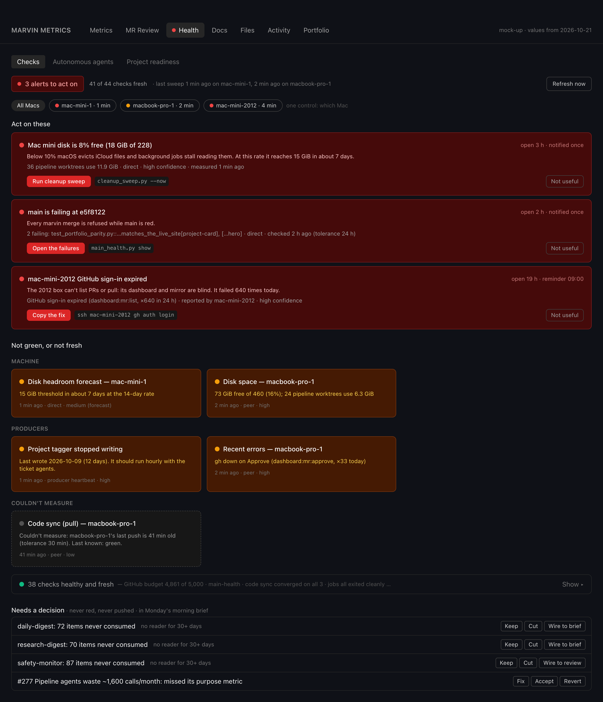
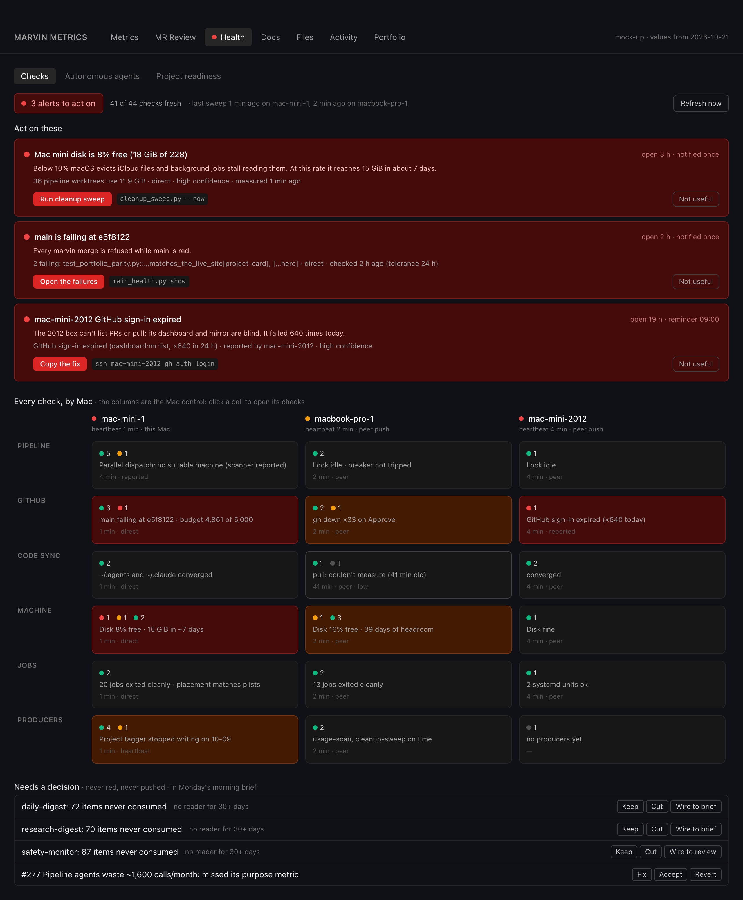
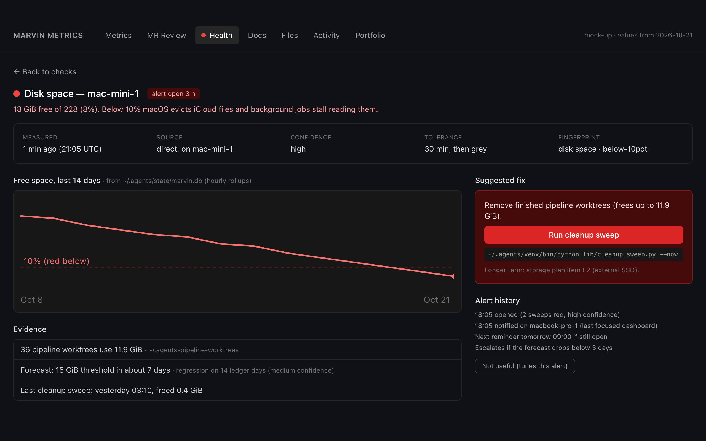

# Health and metrics redo, 2026-10-21

**Ask.** Gil, 2026-10-21: "Health is also broken so I think we should really fix that and make this part of that and
improving health and metrics again." They rejected moving the metrics file into `~/.claude` because "that makes marvin
more reliant on having a subscription and less self reliant", and asked for something more creative and self-reliant.
They approved the direction the same day. This is design only: no production code changes.

**Read first:** `docs/north-stars.md`; CONTEXT.md "Health monitoring", "Databases" and "Triggers over polling"; ADRs 0033
(health framework), 0046 (one proactive delivery path), 0048 (Metrics tab), 0066 (history store), 0021 (code sync),
0032 (Mini as primary host); the pipeline review in draft PR #572 (F1, F8, F11); memory
`feedback-marvin-self-reliance`.

**The one-paragraph answer.** Health doesn't tell the truth today, and its history is the main thing flooding main.
Each Mac should measure itself and keep its own history in a MARVIN-owned SQLite file under `~/.agents/state/`,
gitignored. Each Mac tells its peers the moment something changes, over Tailscale, through the webhook-server it already
runs. Nothing goes through git or `~/.claude`, and nothing needs a subscription. While doing that, drop the 7 check
families that lie or are dead, fix 14, keep 15, and alert only on things Gil can act on, each with a reason and a fix.
The first slice is one small PR. It takes about 45 commits a day off main and stops the sweep crashing.

## 1. What's wrong today (measured 2026-10-21, both Macs and the 2012 box)

| # | Finding | Evidence |
|---|---|---|
| E1 | **The metrics history floods main.** `bench/metrics/health-monitor.<machine>.json/.md` is committed by auto-sync every 30 min. | PR #572 F1: 191 of about 200 auto-sync commits since 10-17. Each one re-runs CI and main-health (433 s), plus an onboarding refresh of about 171 REST calls. **Estimate:** 3.6–4.7 h of M4 CPU and about 4,600 GitHub calls a day. |
| E2 | **The history's only consumer is nobody.** `record_anomaly_metrics` compares this run with *one* previous snapshot. No dashboard code renders `anomaly`. | `grep anomaly dashboard/src` finds nothing. Today it reports the catalog age (1.2 h to 1.4 h) as "regressed". |
| E3 | **The history file grows forever, and each write rewrites all of it.** | `health-monitor.mac-mini.json` is 572 KB with 472 snapshots and no cap. `record()` reads, appends and rewrites the whole file: O(N) per run. An in-place write left trailing junk and blinded Health for a week (607 of the 617 tracebacks in `health-check-error.log`). |
| E4 | **One unreachable Mac kills the whole sweep.** | 3 of the Mini's last 20 runs failed, each on an uncaught `TimeoutExpired` from ssh to the MacBook (`check_sync_stuck`, `check_pipeline_breaker`). A failed run writes nothing, so the tab shows old data as if it were current. |
| E5 | **Health on the MacBook is 6 days old.** | The sweep runs on the Mini only. The laptop's dashboard reads its own `~/.claude/logs/health-status.json`, generated 2026-10-15 19:40 UTC. The 2012 box copies the Mini's file every 10 min on a systemd timer. |
| E6 | **False alarms.** | "webhook-server is not running" on both Macs: `ps -o etimes=` doesn't exist on macOS (now fixed on the gate agent's branch). The snapshot-deploy deploy check is red on the Mini (looks for a run file those jobs never write) and red on the MacBook (demands plists the placement table says must *never* run there). `jobs:placement` is yellow on both Macs from table drift. |
| E7 | **Dead checks that look green.** | `ticket:streak:*` asks gh for issues with the labels `claimed:mac-mini,claimed:macbook-pro`. gh ANDs the labels, so nothing ever matches. `tickets:project-tags` has been stale for 282 h (writer last wrote 10-09). `tickets:hold-revisit` has never been written on the Mini. |
| E8 | **Health is about 30% of the Mini's GitHub calls.** | 4,000 of about 13,100 calls in 24 h: `pr list` 1,955, `issue list` 1,875. They come from `dispatch:parallel` and `profile:missing` re-deriving what the ticket scanner already decided. Each sweep takes 64–99 s. |
| E9 | **Coverage reads 22% and means nothing.** | 6 of 27: it counts Dropbox and Google updater plists, and counts only `cron:*` checks, which come from cron_health's hand-listed 6 jobs (the hand-list ADR 0033 rejected). |
| E10 | **Alerts lean on the subscription.** | `disk_forecast_notify` sends through headless `claude -p` calling PushNotification. Everything else red just sits in the tab: 3 `contract:*` items have been red for weeks (72, 70 and 87 items never consumed) and nobody acts on them. |

Real problems Health got right today, which the redo must keep: main is red; the Mini's disk is at 8% free with a
7-day forecast to the 15 GiB threshold; the 2012 box's GitHub sign-in expired (×640 a day, shown only as yellow); the
MacBook's Approve hit "gh down" ×33.

## 2. Check audit

Every check family `run_all()` produces, 36 in all: **15 keep, 14 fix, 7 drop**, plus 2 new ones. **FP** = false-alarm
risk, **FN** = missed-problem risk. "Source" says how the redo measures it. *Direct* means this Mac measures it itself,
this sweep. *Reported* means the producer writes its own outcome as an event when it happens. *Peer* means it arrives
from another Mac's push.

| Check (id) | What it measures | Accurate today? | FP / FN risk | Verdict | Source after the redo |
|---|---|---|---|---|---|
| `token:oauth-token`, `token:gh-token` | Token files exist, aren't empty, have no whitespace | Yes | Low / medium (a present but expired token reads green) | **Keep** | Direct. Expiry comes from `auth:gh` |
| `route:intent-routing-collection` | Chroma intent collection has rows | Yes | Low / low | **Keep** | Direct |
| `dispatch:lock-age` | How long the dispatch lock has been busy | Yes | Low / low | **Keep** | Direct |
| `ticket:streak:*` | Tickets one failure from parking | **No, can never fire** (labels ANDed) | – / high | **Drop** | The 3-strike park and `pipeline:breaker` cover it |
| `pipeline:breaker` | Cross-ticket circuit breaker tripped | Locally yes; remote read **crashes the sweep** | Low / medium | **Fix** | Reported by `failure_breaker` on trip and clear; peers get it by push |
| `sync:stuck:*` | Code-sync push or pull failing for 30 min+ | Logic yes; ssh read **crashes the sweep** | Low / medium | **Fix** | Reported by `code_sync` after every push or pull; no sync-log parsing over ssh |
| `deploy:missing:*` | Declared plists installed and have run | **No, 2 false reds** | High / low | **Drop** | `jobs:exit` and `jobs:placement` cover every job |
| `dispatch:parallel` | Parallel dispatch is keeping up | Roughly, at about 1,900 GitHub calls a day | Medium / low | **Fix** | Reported by the scanner: it writes its decision and reason each scan. 0 calls |
| `purpose:missed` | Tickets that missed their purpose metric | Yes | Low / low | **Keep** | Direct, with a conditional request (ETag, 304 is free) |
| `contract:*` | Producer output consumed in time | Yes, but red for weeks with no action | High (as an alarm) / low | **Fix** | Moves to the **Needs a decision** lane. Never red, never an alert. One weekly nudge with options |
| `profile:missing:*` | Ready tickets in a project with no profile | Yes, at about 1,000+ calls a day | Low / low | **Fix** | Reported by the scanner (it already lists ready tickets). 0 calls |
| `triggers:missed` | Changes no trigger announced | Yes | Low / low | **Keep** | Direct |
| `catalog:fresh` | Project catalog age | Yes | Low / low | **Keep** | Direct |
| `tickets:project-tags` | Tickets missing a project label | **Stale 282 h; writer stopped 10-09** | High (shows staleness, not a cause) / high | **Fix** | Producer heartbeat: "project tagger stopped writing on 10-09", with a fix. Repair the writer |
| `tickets:hold-revisit` | Held tickets without a revisit date | **Never written on the Mini** | High / high | **Fix** | As above: producer heartbeat, then repair the writer |
| `github:budget` | GraphQL points left this hour | Yes, at 1 call per sweep | Low / medium (15-min sample) | **Fix** | Read from the gate's `gh-budget` stream, recorded from response headers on every call. 0 calls, always current |
| `github:gate` | Calls, refusals, cooldown this hour | Yes | Low / low | **Keep** | Direct, from the gate log |
| `main:green` | Main passes its suite | Yes (red today) | Low / medium (no age shown) | **Keep** | Direct from `main-health.json`, with its age as freshness |
| `seal:beta-ingest` | Seal beta report pickup | Yes | Low / low | **Keep** | Direct |
| `cron:*` (6 jobs) | Failure patterns in 6 hand-listed logs | Partly; hand-list covers 6 of 20 jobs | Low / **high** | **Drop** | `jobs:exit` covers every job from launchd or systemd; producers report outcomes |
| `repo:integrity:*` | Local stash or conflict | Yes, duplicates `repo:sync` | – | **Drop** | Covered by `repo:sync` (same stash and conflict test) |
| `machine:*` | Peer answers ssh | Mostly; ssh timeouts misread as down | Medium / low | **Fix** | Peer heartbeat: time since the last push was *received*, plus Tailscale online (today's `classify_unreachable`) |
| `repo:sync:*` | Each repo converged with origin | Yes | Low / low | **Keep** | Each Mac measures its own and pushes it; the Mini stops ssh-ing into the others |
| `dashboard:build` | Installed app vs. newest dashboard commit | Yes | Low / low | **Keep** | Direct, on each Mac |
| `webhook:build` | Webhook started after newest webhook commit | **No, false "not running"** (`etimes`) | High / medium | **Fix** | Fixed on the gate branch. The webhook reports its own start time at `/health` |
| `auth:gh` | Shared token authenticates | Yes, at about 600 calls a day | Low / low | **Fix** | Derived from the gate log (any 401 or "bad credentials" in the last hour). 0 calls; one probe only when no call ran for an hour |
| `docs:access` | Docs tab can read GitHub | Yes, same credential as `auth:gh` | – | **Drop** | Merged into `auth:gh` |
| `desktoplive:running` | DesktopLive process | Yes | Low / low | **Keep** | Direct; shown as info, never alerted |
| `brainmap:data` | Brain-map data age | Yellow by design on an idle Mac | High / – | **Drop** | Nothing to act on |
| `disk:space` | Free share of the disk | Yes (8% on the Mini) | Low / low | **Keep** | Direct; alertable |
| `disk:headroom` | Days until 15 GiB, from the ledger | Roughly; regresses on entry index, not dates | Medium / medium | **Fix** | Regress on real timestamps from the store |
| `jobs:exit` | Last exit of every MARVIN job | Yes, except it can't see Health itself fail | Low / **medium** | **Keep** | Direct; the self-blind spot closes with the new `health:heartbeat` |
| `jobs:placement` | Loaded jobs vs. the placement table | **Yellow for weeks from table drift** | High / low | **Fix** | Each plist or unit declares its placement (`MarvinPlacement` key). Only `com.marvin.*` and `com.giles.*` count. No hand table |
| `errors@*` | Folded errors per Mac in the last 24 h | Yes, but a dead credential (×640) is only yellow | Low / medium | **Keep** | Each Mac pushes its own. Credential causes escalate to red with the fix |
| `health:anomaly-metrics` and the anomaly compare | This run vs. the last snapshot | **No consumer**; compares to one point | High / high | **Drop** | Phase 4: a rolling baseline (7-day median and MAD) on 3 rate metrics only, from the store |
| coverage | Plists vs. `cron:*` checks | **Misleading 22%** | High / – | **Fix** | Only MARVIN jobs; covered = has `jobs:exit` and a producer heartbeat or check |
| **new** `health:heartbeat@<mac>` | Each Mac's Health is alive, judged by its peers | – | – | **New** | Peer: receive time of the last sweep summary. Catches a dead Health job, which no Mac can report about itself |
| **new** `clock:skew@<mac>` | Peer clock differs from ours | – | – | **New** | Peer: sender time vs. receive time on each push; yellow over 2 min |

**Worst offenders:**
1. The sweep crashing on one ssh timeout (E4). Health goes silently stale.
2. The anomaly layer. It feeds nobody, floods main and once blinded Health for a week.
3. The MacBook's 6-day-old Health tab (E5).
4. The false reds: snapshot-deploy and `webhook:build`.
5. The dead `ticket:streak` check, which can never fire.
6. `dispatch:parallel` and `profile:missing` spending about 3,800 GitHub calls a day to re-derive what the scanner knows.

## 3. Confidence and freshness per check

Every result gains four fields. The tab shows them, and alerts require them.

- `measured_at`: when it was measured, on the measuring Mac's clock.
- `source`: `direct`, `reported` or `peer`.
- `tolerance_s`: declared per check. The Staleness gradient in CONTEXT.md finally gets real per-check values
  (`disk:space` 30 min, `catalog:fresh` 3 h, `main:green` 24 h, a reported producer by its own cadence).
- `confidence`: **high** = measured directly or reported within tolerance. **medium** = measured, but by a heuristic
  (forecasts, Tailscale-inferred sleep) or older than half its tolerance. **low** = couldn't measure (timeout, missing
  producer) or older than its tolerance. A check that couldn't measure is never shown green: it's grey, "couldn't
  measure: <why>", and keeps its last known value for reference.

The tab shows each check's freshness as text ("2 min ago · direct") instead of today's single shared 30-minute fade.
The header shows how much of the picture is trustworthy, for example "41 of 44 checks are fresh", so a stale tab says
so in the header.

## 4. The store: one SQLite file per Mac, under `~/.agents/state/`

**Where:** `~/.agents/state/marvin.db`, gitignored (`state/` in `.gitignore`). It's MARVIN's own directory, so it
works with no Claude subscription and no `~/.claude`. `code_sync` gains a guard that refuses to commit anything under
`state/`, so a mistaken `git add -f` can't put it back on main.

**Why SQLite, not append-only JSONL:**
1. **Writes are atomic.** A crash mid-write leaves the last good state, not a half-written file. A half-written JSON
   file is exactly what blinded Health for a week (E3). JSONL fails more gently but still needs torn-line handling, a
   compactor and an index built by hand.
2. **It's already MARVIN's pattern.** ADR 0066's history store uses this exact table. Both runtimes ship SQLite with
   no new dependency: Python's `sqlite3`, and Node 24's built-in `node:sqlite` (Node 24 is on all three machines).
3. **Queries are cheap.** "The last N hours of one metric" is O(log n + k) on an index, where today it's O(N) parsing a
   whole JSON file.

**Schema:** ADR 0066's `events` table, reused rather than reinvented, plus one view and one cursor table.

```sql
CREATE TABLE events(id INTEGER PRIMARY KEY, stream TEXT NOT NULL, device TEXT NOT NULL,
                    ts REAL, recv_ts REAL, hash BLOB NOT NULL UNIQUE, data TEXT NOT NULL);
CREATE INDEX events_stream_ts ON events(stream, ts);
CREATE INDEX events_device_id ON events(device, id);
CREATE TABLE peer_cursor(peer TEXT PRIMARY KEY, sent_upto INTEGER, recv_upto INTEGER, last_recv_ts REAL);
```

**Streams:**
- `health.result`: written only when a check's *state* changes (severity, confidence or cause fingerprint), not every
  sweep.
- `health.sweep`: one row per sweep: counts, duration, worst check. This is the heartbeat.
- `metric`: numeric samples (`check_id`, value).
- `alert`: opened, escalated, resolved.
- `producer`: reported outcomes (code-sync push or pull, breaker trip, scanner decision).

`hash` covers (device, stream, payload), so the same row arriving twice is one row.

**Volume and complexity:**
- About 64 checks × 96 sweeps a day = 6,144 results a day today, but only state changes are stored: about 50–200 rows a
  day (estimate, from today's file holding 14 numeric metrics with mostly unchanged values).
- Numeric samples: about 15 metrics × 96 = 1,440 rows a day, about 150 KB a day at ADR 0066's measured 116 bytes per
  summary row and about 100 bytes per sample.
- Write: O(log n) per row, one transaction per sweep.
- Current status: O(#checks) from a "latest per check" query (`MAX(id)` grouped by check on the index), never a scan.
- Range for a chart: O(log n + k).

**Retention:** the same rule Gil chose for ADR 0066 on 2026-10-15.
- Raw `metric` samples: 30 days, then rolled up into hourly min, max and mean rows, kept forever.
- `health.result`, `alert` and `producer` rows: kept forever. They're small and irreplaceable (ADR 0065).
- `health.sweep` heartbeats: 30 days.
- Steady state is about 5 MB raw window plus about 1 MB a year of rollups per Mac. That's O(time), bounded by the
  calendar, not by activity.
- The rollup runs inside the sweep that crosses an hour boundary. That's a trigger, not a new timer: O(rows in that
  hour).

**`health-status.json` becomes a view.** Each sweep still writes it with an atomic rename (write a temp file, then
rename it), from the store, so today's readers (the dashboard, the mobile backend's `/health`) keep working unchanged
through the migration. Once every reader asks the store or the webhook, the file goes away.

**ADR 0066's history store moves too (recommended).** `~/.claude/history.db` becomes `~/.agents/state/history.db`, by
the self-reliance rule. It's a path change plus a one-time file move per Mac, under a new ADR that amends 0066's
location. It's listed in Decisions only as a confirm.

## 5. Sharing: peer to peer over Tailscale, push on change

There's no git, no `~/.claude`, no ssh reads and no polling timers. Each Mac's **webhook-server** (already running on
both Macs, port 7878, ADR 0032) gains three routes. Its Tailscale identity check is the same `tailscale whois` gate the
mobile backend already uses (`device_gate.js`). The allow-list is the devices in the machine registry.

| Route | Who calls it | What it does |
|---|---|---|
| `GET /health` | Dashboards, the phone backend, peers | This Mac's current status from the store, plus `served_at`, the webhook's own start time and its newest `id` |
| `POST /events` | A peer, right after it commits rows | Validates (registered device, at most 1 MB and 5,000 rows, known streams, JSON object payloads) and inserts with `INSERT OR IGNORE` on `hash`. Answers `{recv_upto, your_rows_upto}` |
| `GET /events?device=<me>&after=<id>&limit=5000` | A peer catching up | Returns this Mac's own rows after `id`, in id order |

**Push on change.** When `health_checks.py` (or a producer) commits rows, it POSTs the new rows to each peer's
`/events` with a 2-second timeout. It doesn't wait for a reply, and a failure is just remembered: `sent_upto` stays put.

**Catch-up on contact.** There's no timer. Catch-up happens in four cases:
1. **On webhook start**, which includes boot and wake, because launchd restarts it.
2. **On the dashboard opening Health.**
3. **Piggyback.** Every POST reply carries `your_rows_upto`: the highest id of the *receiver's* rows the sender holds.
   If that's behind, the receiver pushes the missing rows right away. Any contact in either direction (one Health sweep
   or one producer event) re-syncs both sides.
4. **When a peer's push arrives after a gap**, meaning `last_recv_ts` is older than the peer's tolerance. The receiver
   answers by sending whatever it owes that peer.

A batch is at most 5,000 rows, so a laptop back from a week away catches up in a few round trips: O(missed rows).

**Edge cases:**
- **Offline or asleep peer.** Rows stay in the sender's own store, which is the outbox: nothing is lost and nothing
  queues in memory. The receiver shows the peer as asleep or unreachable using today's `classify_unreachable` (keyed on
  device kind and Tailscale's last seen), now fed by `last_recv_ts`.
- **Clock skew.** Order comes from each device's own `id`, never from timestamps across machines. Freshness of a peer
  is judged on the *receiver's* clock (`now - recv_ts`). Each push compares the sender's `ts` with `recv_ts`, and over
  2 minutes raises `clock:skew@<mac>`.
- **Duplicates.** `hash UNIQUE` plus `INSERT OR IGNORE` make every push and catch-up idempotent. Running twice adds
  nothing.
- **Half-written data.** A row is pushed only after its transaction commits. A torn HTTP body fails JSON parsing and is
  rejected whole (the sender retries by cursor). The receiver inserts each batch in one transaction, so it lands all or
  nothing.
- **Forged or hostile requests** (tests try to break it). Non-Tailscale or unregistered IPs get 403. Oversized bodies
  get 413. Unknown streams, non-object payloads and a `device` that doesn't match the caller's identity are rejected (a
  Mac can only write its own rows). Payload text is never executed or rendered as HTML. Floods are capped at one
  in-flight batch per peer.

**Each Mac measures only itself.** The Mini stops ssh-ing into the others for sync-log, breaker, errors and machine
state. Every Mac runs the same local sweep. The sweep is still 15-minutely for things with no event of their own (disk,
the clock, git convergence). Everything with a producer becomes reported (Phase 4). Each Mac's Health tab shows all
Macs: its own rows, plus peer rows from its store. So the MacBook is never more than one wake-up behind, instead of 6
days.

**North-star fit:**
- *Reuses* the events schema, the webhook-server, the whois gate, `classify_unreachable` and the `health-status.json`
  shape.
- *Deletes* the ssh fan-out in health_checks (4 remote readers), the anomaly compare, the metrics stash-merge special
  case in `code_sync` (once no `health-monitor` file is tracked) and the 2012's 10-minute copy of the Mini's file.
- *Saves* about 45 commits a day and their cascade (about 4 h of M4 CPU and about 4,600 calls a day, estimated), plus
  about 3,800 of Health's own GitHub calls a day.
- *Phone-OS*: one `GET /health` per machine is linkable, works offline from the local store and is reachable from
  anywhere on the tailnet.
- *Self-reliance*: every piece runs with no Claude subscription.

## 6. Alerts worth getting

Gil, on today's notifications: "fine and a good start but not super helpful to me always". An **alert** is a new
object, separate from a red card, built only for things a person should act on.

- **When one opens.** A check is red with **high** confidence on two sweeps in a row, or a reported producer failure
  (one is enough). Yellow never alerts. Low confidence never alerts, except that a Mac whose Health heartbeat stopped
  alerts *from its peer*.
- **Deduplicated** by fingerprint (check id and cause class, for example `disk:space@mac-mini-1` / `below-10pct`). One
  open alert per fingerprint. It notifies again only when it escalates (yellow to red, or the forecast drops below 3
  days), or as a once-a-day reminder while it's still open. It resolves itself with a "resolved after 3 h" note.
- **Content** (every field required; a check without a `fix` can't alert): *what* ("Mini disk 8% free, 18 GiB"), *why
  it matters* ("below 10% macOS evicts iCloud files and background jobs stall"), *evidence* (the value and the
  freshness), *the suggested fix* (a command or a dashboard button: "36 pipeline worktrees use 11.9 GiB: run cleanup
  sweep"), and *confidence*.
- **Needs a decision** is a separate lane: the `contract:*` "never consumed" items and missed purposes. Never red,
  never pushed. It's one weekly line in the morning brief with options to keep, cut or wire up, using the Decisions
  format, not prose.
- **Delivery on MARVIN's own path, not `claude -p`.** The alert is written to the store and pushed to peers. Then:
  - each Mac's webhook pings its dashboard (the `/refresh` relay) and shows a native notification through `lib/notify.py`
    (terminal-notifier, click opens the alert), only on the Mac where the dashboard was focused last;
  - the phone gets it through ADR 0046's proactive path (APNs into the Thread, with quiet hours) when that's built (it
    isn't yet: no APNs code is in the mobile backend today);
  - `disk_forecast_notify`'s `claude -p` → PushNotification sender is deleted.
- **Gil can tell MARVIN an alert was noise.** Each alert has a **Not useful** button. It records the fingerprint, and
  ADR 0046's acted-on and ignored record tunes thresholds from it. The success measure is false alarms per week (§9).

## 7. Migration (once)

1. **Import.** On each Mac, a one-time script loads `bench/metrics/health-monitor.<machine>.json` (472 snapshots on the
   Mini, 8 on the MacBook) and the legacy bare `health-monitor.json` into `metric` rows. It's idempotent by hash, and it
   verifies row counts against snapshot × metric counts before step 2.
2. **Stop the commits.** `git rm --cached bench/metrics/health-monitor.*` and add those paths to `.gitignore`. The
   history stays in git's log up to that commit. `metrics_registry.record("health-monitor", …)` is removed with the
   anomaly compare. No other caller writes that subsystem.
3. **Update the readers.**
   - `health_checks.py`: drops `record_anomaly_metrics` and `anomaly_or_red`.
   - `dashboard/electron/main/metrics.js`: stops listing `health-monitor` as a benchmark card; the files are gone.
   - `dashboard/electron/main/health.js` and `mobile-backend/dashboard_api.js`: read `GET /health` (this Mac and peers)
     instead of the local file. Until then, the file is still written as a view.
   - `code_sync.py`: drop the metrics stash-merge special case once no auto-synced file is under `bench/metrics/`
     (ticket metrics are committed by the pipeline, not auto-sync). Add the `state/` refuse-to-commit guard.
   - `lib/tests/test_metrics_registry_safety.py`: retarget it at the store's atomicity.
4. **Move ADR 0066's `history.db`** to `~/.agents/state/` (one file move per Mac, and a path constant).

## 8. Optional consumers

- **The 2012 Linux node.** It runs the same local sweep through a systemd *path* unit on its own job outputs (not a
  timer), plus the webhook routes with Node 24 (already installed). Its expired GitHub sign-in becomes one red alert
  with the fix (`gh auth login` on mac-mini-2012) instead of yellow ×640 a day. Its 10-minute copy of the Mini's
  `health-status.json` is deleted.
- **The phone backend.** `GET /health` already exists in `mobile-backend/dashboard_api.js`. It calls the Mini's
  webhook `GET /health` for all Macs (the Mini holds every peer's rows). Alerts arrive through ADR 0046 when it lands.

## 9. Phases (smallest valuable slice first)

Each phase is one PR with tests that try to break it (ADR 0063).

| Phase | What | Acceptance tests | Success measure |
|---|---|---|---|
| **P0: stop the flood, stop the crash** (about 1 day) | Gitignore and untrack `bench/metrics/health-monitor.*`. Delete the anomaly compare. Wrap each check in a timeout guard: one failing check becomes a grey, low-confidence result, never a dead sweep. Drop `ticket:streak`, `deploy:missing`, `brainmap:data`, `docs:access`, `repo:integrity`. | An ssh stub that times out still produces a written status, with that check grey and the reason. A run with the metrics file corrupted still writes status. `git status` stays clean after 3 sweeps. | Auto-sync commits a day: 48 → under 5 (3-day average). Main-health runs a day: about 30 → only real merges. Failed sweeps: 3 of 20 → 0 in 48 h with the MacBook asleep. |
| **P1: the store and honest checks** | `~/.agents/state/marvin.db` (events, results on change, sweep heartbeat, metric samples, hourly rollup). Freshness and confidence fields. Fix the 14 "fix" checks that need no peer. One-time import. `health-status.json` written as a view. | Kill -9 mid-sweep leaves the store readable and the last view intact. Import run twice adds 0 rows. Rollup across an hour boundary. Per-check tolerance greys exactly at its limit. | False or noisy reds and yellows: about 9 standing today → 0. Coverage counts only MARVIN jobs. |
| **P2: peer push** | Webhook `GET /health`, `POST /events`, `GET /events`. Push on commit, catch-up on start, open and piggyback. The sweep runs on every Mac, locally only. ssh readers deleted. | Forged IP → 403. Wrong-device rows → rejected. 2 MB body → 413. Duplicate batch → 0 rows. A peer asleep 3 days catches up in batches of 5,000 or fewer. 10-min clock skew → `clock:skew`. | MacBook Health age after wake: 6 days → under 1 min. ssh calls from Health: about 15 per sweep → 0. |
| **P3: alerts** | Alert objects (open, escalate, resolve), fingerprints, required fix text, the Needs a decision lane, delivery via `/refresh` and `notify.py`, the **Not useful** button. `disk_forecast_notify`'s `claude -p` path deleted. | The same red over 10 sweeps → 1 notification. Escalation → 1 more. A check with no fix can't alert. Resolution posts once. | Alerts a week, and the share marked Not useful (target under 10%). |
| **P4: producers report** | The scanner reports its dispatch decision and missing profiles. `code_sync` and `failure_breaker` report outcomes. `github:budget` and `auth:gh` come from the gate log. Rolling-baseline anomaly on 3 rates (GitHub calls an hour, errors an hour, comments an hour). | Scanner decision visible in Health within one scan, with 0 extra gh calls. A budget change shows without a GraphQL call. | Health's GitHub calls: about 4,000 a day → under 300. Sweep duration: about 73 s → under 15 s. |
| **P5 (optional)** | The 2012 node and the phone backend as consumers. ADR 0066 `history.db` moved to `~/.agents/state/`. | The 2012 node's credential expiry → 1 red alert with the fix. | |

**Tracking the measures.** Commits a day come from `git log --author auto-sync`. M4 CPU comes from main-health run
count × duration, which needs `main-health.json` to keep more than the latest run (PR #572 F11). GitHub calls come from
`gh-calls.jsonl` by caller. False alarms a week are the **Not useful** count plus alerts resolved within one sweep.

## 10. Mock-ups of the redone Health tab

Drill-down map first (one control per level, memory `feedback-one-control-per-drilldown-level`):

**Health → Machine → Area → Check → Evidence and fix**

- **Health tab:** the existing view switch (Checks / Autonomous agents / Project readiness) stays and is the only
  control at this level. A new **Alerts** strip sits on top of Checks. It isn't a filter: it lists what to act on.
- **Machine:** one control, the machine chips (All, mac-mini-1, macbook-pro-1, mac-mini-2012), each showing its own
  heartbeat age.
- **Area:** no control. The checks are grouped under fixed headings (Pipeline, GitHub, Code sync, Machine, Jobs,
  Producers).
- **Check:** click opens today's drill-down (`HealthDrilldown`), which gains the evidence history, freshness, confidence
  and the fix.

Gil has to pick between two layouts for the Checks view:

- **Option A: problems first.** Alerts at the top, then only checks that aren't green and fresh, then a collapsed
  "38 healthy and fresh" row. It's the shortest path to "what do I do".
- **Option B: machine grid.** One column per Mac and one row per area, each cell a dot with freshness. It gives the
  whole picture at a glance, and asleep or stale Macs are obvious, but it's denser.





## 11. Decisions for Gil

They're in the PR description in the Decisions format.

1. Which Checks layout (A or B)?
2. Confirm moving ADR 0066's `history.db` out of `~/.claude`. This is recommended under the self-reliance rule.
3. Which alert delivery to start with, before the phone path exists?
4. Whether the 2012 node joins Health in P5 or later.
