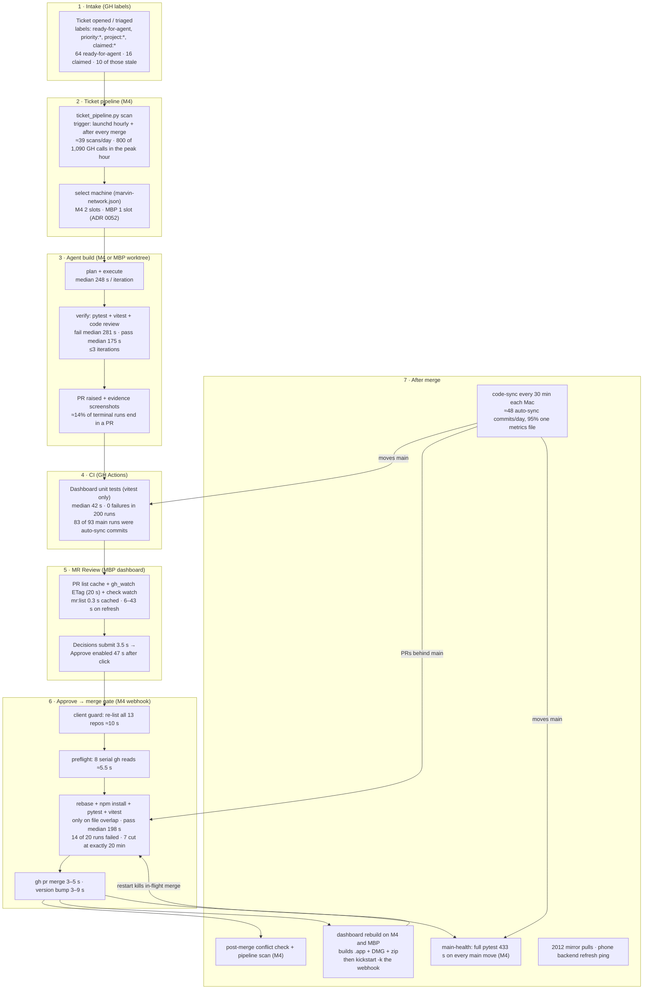

# Delivery pipeline review, 2026-10-21

Gil asked (2026-10-21, after seeing the merge progress bar from PR #569 "MR Review: merge progress bar (stage by stage,
pushed live)") for the whole workflow to be scrutinised end to end: "simplify, streamline, optimize, and make sure the
system remains robust and following our north stars." This is analysis only. Nothing was changed, filed, merged or
restarted. Every number below was measured from logs on both Macs or read-only GitHub calls on 2026-10-21, unless it is
marked **estimate**.

Read first: `docs/north-stars.md`, `CONTEXT.md` ("Triggers over polling"), ADRs 0021, 0026, 0032, 0052, 0061, 0064, and
the memory rules on north stars and patterns, complexity, robustness and owning the whole system. Vocabulary follows
`skills/improve-codebase-architecture/LANGUAGE.md` (module, interface, depth, seam, deletion test).

**The one-paragraph answer.** The pipeline's core decisions are sound: one merge queue per repo, retest only on file
overlap (ADR 0061), structured refusals, triggers over polling. What makes it slow and fragile is not the design of any
single step. It is **cascades**: a small piece of churn upstream fans out into large amounts of work downstream. Half of
all commits on main are a health-check metrics file (191 of 200 auto-sync commits since 10-17), and every one of them
re-runs CI, re-runs the 7-minute main-health suite, re-downloads about 171 files from GitHub, and makes every open PR
"behind main". Every merge that touches the dashboard rebuilds the app and **restarts the merge server with
`kickstart -k`, killing any merge in flight**. Approving goes through 8 serial GitHub reads and a re-list of all 13
repos. Answering Decisions waits for a 43-second re-list of every repo before Approve lights up. And a few silent
defects (conflict auto-repair has crashed 523 times since 10-10, 10 tickets hold stale claims, tests write fake errors
into the real logs) hide what's really happening. Most of the fixes are deletions.

---

## 1. The map

Machines: **M4** = Mac mini `mac-mini-1` (`gils-mac-mini`), the automation host (ADR 0032). **MBP** = MacBook Pro
`macbook-pro-1`, where Gil uses the dashboard. **2012** = Linux node `mac-mini-2012`, a pull-only mirror (ADR 0069).
**GH** = GitHub.

| # | Step | Machine | Trigger | Measured time | Measured failure rate |
|---|------|---------|---------|---------------|-----------------------|
| 1 | Intake / triage | GH, Gil, agents | Gil or agents label | n/a | 10 of 64 ready tickets invisible behind stale `claimed:*` for 5–11 days |
| 2 | Scan + dispatch | M4 | launchd 3600 s + after each merge | ≈39 scans/day; post-merge scan ≈75 s of serial GH reads | `ticket agents` crashes on every scan (270×); conflict repair crashes (523×) |
| 3 | Agent build | M4 / MBP worktree | dispatch | execute median 248 s, verify median 175–281 s per iteration | 20 PRs raised vs ≈120 failed runs in the surviving stage files (≈14%) |
| 4 | CI | GH | every PR push and every main push | median 42 s, p90 83 s | 0 failures in 200 runs (41 h) |
| 5 | MR Review | MBP | gh_watch every 20 s, check watch, local file watch | list refresh 6–43 s; Decisions → Approve enabled 47 s | 23% of merges since 10-14 done on GitHub instead (6 of 26) |
| 6 | Approve → gate → merge | MBP → M4 | Gil's click | no-gate Approve 8.8–16.4 s server-side (n=8), 23.7 s end to end (#569); gated pass median 198 s | 16 refused Approves vs 24 dashboard merges since 10-10 (40% of clicks) |
| 7 | After merge | M4, MBP, 2012 | merge, gh_watch, launchd | rebuild minutes; main-health 433 s | webhook restarted 20 times, 9 of the last 12 within ~4 min of a dashboard merge |
| 8 | Cross-cutting | all | n/a | ≈22,000 GH calls/day across both Macs (13,112 M4 + 8,926 MBP) for ≈4 merges/day | `main:green` red since at least 19:40 UTC; 2012 dashboard "GitHub sign-in expired" ×665/day |

---

## 2. Findings

Tags: **[dup]** duplication · **[frag]** fragility · **[waste]** wasted work · **[blind]** missing feedback to Gil ·
**[keep]** good, should stay.

### F1. Half of main's commits are one metrics file, and each one fans out [waste]

- 360 of 766 commits on main since 10-07 are `auto-sync` (47%). Since 10-17 it is steady at ≈48/day.
- Since 10-17, **191 of about 200** auto-sync commits change only `bench/metrics/health-monitor.mac-mini.{json,md}`.
  The writer is `health_checks.py` (every 15 min on the M4) through `metrics_registry.record`; its only reader is the
  same health check, comparing against its own last record. It is local state committed to a shared repo.
- Each such commit moves `origin/main`, which triggers, per commit:
  - a CI run on main (83 of the last 93 main pushes were auto-sync);
  - a full main-health run when the next scan sees a new sha (2,602 tests, 433 s);
  - an onboarding-plan refresh of marvin that downloads ≈171 files one REST call at a time (see F8);
  - every open PR becoming "behind main", so the gate's overlap check runs on more Approves.
- **Estimate:** ≈30–39 main-health runs/day × 433 s ≈ 3.6–4.7 h of M4 CPU a day, nearly all testing a metrics file.
  (Not measured directly: `main-health.json` keeps only its latest result.)

ADR 0021 (code-sync auto-commits `~/.agents`) is not re-litigated here. This is new evidence for scoping
machine-generated data out of what it commits.

### F2. A dashboard merge restarts the merge server and kills any merge in flight [frag]

- `dashboard/scripts/rebuild_and_install.sh` ends with `launchctl kickstart -k …com.marvin.dashboard-webhook`.
- Two separate modules start it: `merge.js` `triggerRebuildIfDashboardChanged` (right after a merge) and
  `rebuild_check.js` → `lib/dashboard_rebuild.py` (on any gh_watch change to marvin). **[dup]**
- The merge queue (`inRepoQueue`) lives in memory, so a restart drops it. M4 webhook restarts: 20 in the log, and 9 of
  the last 12 came within ~4 minutes of a merge that touched `dashboard/`.
- Today: #559 merged 19:26:32 UTC → restart between 19:26:43 and 19:33:38 → in-flight work lost, card stuck on
  "Merging…" → Gil merged #561, #567 and #562 on GitHub at 19:41–19:43 → `rebuild_check` fired on those → second restart
  at 19:48:03 (pid 27811 start time matches the rebuild log's mtime to the second).
- PR #569 now records in-flight merges in `merge-inflight.json` and shows "interrupted" after a restart. That is
  honest, but the merge still dies and Gil still has to press Approve again.
- Each rebuild also builds a DMG and a zip with block maps that nothing installs (MBP log: 18 DMG builds for 19 installs).
  **[waste]**

### F3. The gate's 20-minute cut is a per-command kill, and the real cause looks like a hang, not load [frag]

- Gate runs since 10-10: **20**. Passed 6 (median 198 s, max 339 s). Failed 14: 7 `GATE_INFRA`, 5 `MAIN_RED`
  (one PR, #400 "Implement #218", five times), 1 rebase-repair crash, 1 real `GATE_TESTS_FAILED`.
- All 7 `GATE_INFRA` durations are **1201–1217 s**: #444 "Rename the desktop app to MARVIN" 4× on 10-15 and #559 3×
  today. That is `execWithGroupTimeout`'s `DEFAULT_TEST_TIMEOUT_MS = 1200_000` killing pytest, not the 40-min
  `GATE_TIMEOUT_MS`. **PR #569's load-aware extension acts on the 40-minute timer, which a single pytest run can never
  reach**, so it would not have saved #559.
- A load slowdown would scatter the durations; a hang gives the same number every time. Live evidence of a hang: at
  14:18 MDT today a main-health `pytest lib/tests` (pid 42917) sat at **0% CPU** with a child `du -sk
  /Users/gileskayo/Documents` (pid 46849) blocked for 6.5+ minutes. That is the known launchd/TCC block on iCloud
  `~/Documents` (memory: launchd-documents-tcc-block), reached by some test through the real `disk_ledger`. `conftest.py`
  stubs only `run_daily_ledger`, so a test that reaches `disk_ledger.du` by another path still runs it. **Which test
  could not be identified without a stack sampler.**
- There is no per-test timeout (`pytest-timeout` isn't installed) and no parallelism (`xdist` isn't installed), so one
  hung test burns the whole 20 minutes and names no test. 3.0 h of M4 time went on failed gates.

### F4. Approve does 8 serial GitHub reads plus a full re-list of every repo [waste]

PR #569's Approve, from the M4's `gh-calls.jsonl` and both Macs' `dashboard-timing.jsonl`:

| t (UTC) | what | cost |
|---|---|---|
| 20:24:19.9 | click (`mr:approve` starts on the MBP) | |
| → 20:24:30.3 | `guardApprove` → `listOpenPrs({ fresh: true })`: re-lists all 13 repos to check merge order | **10.4 s** |
| 20:24:30.4 → 35.9 | webhook preflight: `pr view` ×7 + `issue view` ×1, one at a time (baseRefName, body, labels, isDraft, files for UI evidence, Decisions, headRefName+body, statusCheckRollup) | **5.5 s** |
| 20:24:35.9 | gate skipped (behind main, no shared files) | |
| 20:24:36.1 → 39.2 | `gh pr merge` | 3.1 s |
| 20:24:39.2 → 43.0 | version bump | 3.8 s |
| 20:24:43.5 | done; `mr:approve` returns (23.7 s) | |
| 20:24:58 | list refreshed again (two `mr:list`, 9.3 s and 15.1 s) | |

Of 23.7 s, about 16 s is re-reading things the dashboard and the webhook already know. Each `gh` call through the gate
also costs a Python start-up (≈300–600 ms per call even when GitHub answers fast).

### F5. A dashboard action waits on GitHub and a full re-list before it shows its own result [frag, blind]

Gil, 20:40 UTC: "it is still being too slow for me for the workflow I would like but it just switched to approve like a
minute later." Traced on the MBP:

- 20:23:17.9 Submit decisions → `decisions_submit.js`: GET the issue, PATCH the body, POST the record comment, in
  series through the gh gate: **3.45 s**.
- Then `githubChanged(null)` invalidates **every** repo (`changedAll`), and `onSubmitted` → `reloadKeepSelected`.
  Three overlapping `mr:list` calls ran (17.1 s, 35.2 s and **43.3 s**), with `mr:reviewStatus` (11.7 s) and
  `mr:parity` (15.2 s) competing for the same gate. All landed at 20:24:04.
- **Approve became available 46.7 s after the click.** The answer was already in the main process at 3.45 s
  (`applyAnswers` computed the new body). The card waited on GitHub to tell it what it had just written.
- Same shape elsewhere: after Approve, `githubChanged(null)` again re-lists all 13 repos. Through the day, `mr:list`
  refreshes cost 6.5 s, 6.7 s, 12.9 s, 20.0 s and 17.1 s between 20:13 and 20:19 alone.

Principle (Gil, 2026-10-21): an action Gil takes in the dashboard updates the dashboard at once, from local state,
confirmed in the background. It never waits on a GitHub round trip or a timer tick to show its own result.

### F6. The ticket pipeline has three silent defects that each fire on every scan [frag, blind]

- **Conflict auto-repair has never worked since 10-10.** `ticket_pipeline._try_conflict_repair` passes
  `do_repair=lambda r, h, c, b: …` but `conflict_repair.attempt` calls `do_repair(repo, head, clone, base, pr=pr)`.
  Result: `repair crashed: …<lambda>() got an unexpected keyword argument 'pr'`, **523 times** (266 on #217, 216 on #81,
  39 on #417), every scan, still at 20:18 today. Each crash falls back to "rebuild" and is logged as a gate failure on
  the ticket's timeline.
- **`ticket agents: 'NoneType' object has no attribute 'startswith'`** on 270 of 273 logged scans.
- **10 tickets are invisible to dispatch behind stale claims**: #53, #231, #411, #453, #454, #455, #457, #458, #459,
  #460. Each ended with "Planning model could not produce a concrete task list" on 10-10 or 10-16 and kept its
  `claimed:*` label. The dispatcher only takes unclaimed tickets, so these sat 5–11 days. Only #563 and #565 have live
  task records.
- **Retry without backoff under load:** #563 was claimed at 19:33, 19:56 and 20:19 today, and each run died at the
  1200 s verify timeout while the M4 ran the #145 engine test.

### F7. The pipeline re-reads the same non-work every scan [waste, blind]

- Each logged scan re-checks 11 tickets that are labelled `ready-for-agent` but already done ("looks-done: PR #325
  merged…", "7b36f98 Triage…"). That is 4,653 skip lines over 273 scans. These tickets should be closed or relabelled
  once.
- "portfolio-website-updater #2 / marvin-mobile #2 ready but no suitable machine currently available", 132× each.
  **Correction to an earlier read:** this is configuration, not capacity. `config/projects/portfolio-website-updater.json`
  and `marvin-mobile.json` both have `"machines": []`, so no machine can ever qualify. The message should say "not set up
  for agents" once, not "no machine available" every hour.

### F8. The onboarding refresh downloads the marvin repo file by file, every scan [waste]

- 4,617 of the M4's 13,112 GitHub calls in the last 24 h are `api repos/G-Eskayo/marvin/contents/…` from the scan
  (`project_onboard.py`), about 171 per scan. In the 20:24 post-merge scan they ran one at a time from 20:24:56 for over
  a minute (`git/trees?recursive=1`, then each `lib/tests/test_*.py`, `brain-map/scripts/test_*.py`…).
- The scan runs on the machine that holds the clone (`~/.agents`). `git ls-tree` / `git show` answer the same question
  locally in milliseconds. Marvin's plan is "refreshed" on every scan because main moves every 30 minutes (F1).

### F9. The GitHub gate's background protections are mostly bypassed [frag]

- The gate (`bin/gh`) treats `com.marvin.*` launchd jobs as background (2 slots, 0.25 s spacing, 20% budget floor) and
  everything else as interactive.
- In 58 h on the M4: `ticket_pipeline` made **13,666 calls classed interactive** and 1,485 background. `health_checks`
  made 4,455 interactive and 5,512 background. Scans started by the webhook (`triggerTicketPipeline`) inherit the
  webhook's interactive exemption, and the hourly scan's `gh` children also show up as interactive. That exact
  inheritance path is unconfirmed.
- Budget isn't binding today (GraphQL 93%, core 99%), so this is a latent risk, not a current outage. But it means the
  bulk scan competes with Gil's clicks at equal priority, which is part of F4 and F5.
- Total ≈22,000 calls/day across both Macs for ≈4 merges/day. On the MBP, `rework_status` makes 3,187/day and the
  dashboard app 5,221/day. Cumulative `gh` wall time: 116 min/day on the M4 and 486 min/day on the MBP.

### F10. Tests write into the real logs, so the evidence is polluted [blind, frag]

- `gate-run-durations.jsonl`: all 74 lines are test fixtures (`verify:o/x`, `durationMs: 0`, 10-15 to 10-17). The real
  gate never wrote this file until #569's `merge_progress.js`, which now uses a temp HOME and ignores the old lines.
  **That is the full answer to "durationMs: 0 everywhere".**
- `errors.jsonl`: 147 of 160 `dashboard:mr:approve` "mr:approve failed" entries are `Error: gh down` thrown by
  `dashboard/test/timing.test` running in worktrees. Health's `errors@macbook-pro-1` today reports "gh down ×19". All
  fake.
- This is the same class as the 2026-10-09 `~/.claude/logs` wipe (memory). A rule exists ("tests use temp HOME"), but
  nothing enforces it suite-wide.

### F11. Main-health has no single-flight lock, no per-test timeout, and its refusal is not enforced [frag, blind]

- Every scan starts `main_health.py refresh` with `Popen(start_new_session=True)`, no lock. Two ran at once today
  (pids 29838 from 13:55 and 42917 from 14:18 MDT). 42917 is the blocked `du` above.
- Its `_run_suite` timeout is 1800 s per run. Overlapping runs pile up while a test is blocked.
- ADR 0061 relies on main-health as the backstop: "merges are refused while main is red." **No code does that for human
  Approves** (`merge.js` has no main-health check; only `boot_data.js` reads `main:green`). Main has been red today
  (2 portfolio tests at e5f8122) while #569 merged. Arguably right (a fix must be mergeable onto red main), but then the
  ADR and the `health_checks.py` text overstate the backstop.

### F12. The test triple is uneven: one layer earns its keep, one is cheap insurance, one mostly cries wolf

| Layer | Where / cost | What it caught (measured) | Verdict |
|---|---|---|---|
| Agent verify (pytest + vitest + code review) | worktree, ≈3–5 min per iteration | 209 failed verifications before any PR (89 "must-fix" review findings, 62 unchanged, 36 mixed, 13 regressed) | **[keep]**: this is where quality is enforced |
| CI (vitest only) | GitHub's compute, 42 s, no M4 cost | 0 failures in 200 runs | **[keep]** as cheap clean-room insurance. Stop feeding it metrics commits (F1) |
| Merge gate (full pytest + vitest after rebase) | M4, 198 s pass, 20 min on hang | 1 real catch (#218) in 20 runs; 13 infra/main-red failures | **[frag]**: right idea, poor precision until F3 is fixed |
| main-health (full suite) | M4, 433 s per main move | caught today's red portfolio tests | **[waste]** at today's frequency; **[keep]** per merge |

Interactive work (Gil's sessions) skips agent verify, so for those PRs the gate and CI are the only checks. The #557/#559
collision is the case ADR 0061 accepted as rare: no shared file, but #557 added code that #559's new repo-wide polling
guard rejects. The overlap rule correctly skipped the full retest. What would have caught it in seconds is running the
repo-wide **guard tests** at every Approve (see P7).

### F13. Things that are good and should stay [keep]

- **One merge queue per repo** (`inRepoQueue`): no "Base branch was modified" races since it landed.
- **Retest only on overlap** (ADR 0061): 30 of the 36 recorded merges went straight to merge with no retest. #569 merged with no retest in 13 s.
- **Post-merge conflict check with `git merge-tree`**: seconds, no checkout, replaced ≈8 test runs per merge.
- **Structured refusals** (`failure.js`: code, stage, remediation; GATE_INFRA doesn't send back): the right interface.
  Refusals were honest every time.
- **ETag change detector** (`gh_watch.js`): 304s are free. It is the right trigger and should replace more polling.
- **The GitHub gate as one choke point**: the idea is right; its classification is what's off (F9).
- **#569's merge progress stream**: exactly the "never silent" direction. Keep it, and make the restart case resume
  rather than only report (P2).

### F14. Smaller gaps worth knowing [blind]

- Health says `webhook:build@mac-mini-1 webhook-server is not running` while pid 27811 is serving; same on the MBP.
  A false alarm that teaches Gil to ignore Health.
- `mac-mini-2012`: `GitHub sign-in expired (dashboard:mr:list, ×665)` in 24 h. The mirror's dashboard has no working
  credential.
- M4 disk: 19 GiB free of 228 (8%); 36 pipeline worktrees hold 11.9 GiB; 7-day forecast to the 15 GiB threshold.
- Agent build success per run is low (≈14%). Leading causes: "did not reach a passing comparison after 3 iterations"
  (42), verify timeouts at 1200 s (≈37), "planning model could not produce a concrete task list" (18). Out of scope
  here beyond F6, but it is the biggest quality lever upstream.

---

## 3. Proposals, ranked by leverage

Ranked by what each one removes downstream (compounding leverage), then by size. Sizes: XS < 1 h, S ≈ half a day,
M ≈ 1–2 days.

### P1. Take machine-generated metrics off main (removes ≈95% of auto-sync commits)

- **Removes:** ≈45 commits/day on main and their cascade: ≈45 CI runs, ≈30 main-health runs (≈3.6–4.7 h M4 CPU,
  estimate), ≈30 onboarding refreshes (≈4,600 REST calls), and constant "behind main" on every open PR. No step added.
- **How:** `metrics_registry` writes `health-monitor.*` under `~/.claude/logs/metrics/` (or gitignores it in
  `bench/metrics/`). Its only reader is the same health check, on the same machine. Generalise: code-sync never commits
  paths a job regenerates. The rule lives in the code-sync allowlist, not in each writer.
- **North-star fit:** reuses the existing `~/.claude/logs` local-state convention; deletes work rather than adding a
  filter; the largest token/compute saving here (north star 1). Leaves Gil no more passive. Reliability gain (fewer moving
  parts) serves north star 2.
- **Risks:** anything that expected the metrics history in git (the portfolio or brain-map) loses it. Grep found only
  `health_checks.py` and `metrics_registry.py`. History stays in git up to the change.
- **Complexity:** O(1) per health run instead of O(commit + CI + suite) per run. Space: bounded by the registry's own
  trim.
- **Measure:** auto-sync commits/day (48 → under 5), CI main runs/day, main-health runs/day, M4 gh calls/day.
- **Size:** S.

### P2. Make a restart unable to kill a merge (one rebuild path, drain before restart, resume)

- **Removes:** the second rebuild trigger (`triggerRebuildIfDashboardChanged` in `merge.js`; keep `rebuild_check` →
  `dashboard_rebuild.py`, which already has the settle, back-off and "already running" guards). Also the DMG and zip
  targets (`electron-builder --mac dir`).
- **Changes:** `rebuild_and_install.sh` restarts the webhook only when `merge-inflight.json` (from #569) is empty, or asks
  the webhook to drain: a SIGTERM handler stops taking new merges, finishes the current one, then exits so launchd
  restarts it. On start-up, the webhook re-runs any merge left in `merge-inflight.json`. Every step is already idempotent
  or guarded (`gh pr merge` on a merged PR is detected; the gate is a no-op when caught up).
- **North-star fit:** deletes a duplicate module (deletion test: removing `triggerRebuildIfDashboardChanged` loses
  nothing, `rebuild_check` covers every merge path, #443). Reuses #569's in-flight store. "Nothing may break silently"
  (north star 2).
- **Risks:** a stuck merge could delay a rebuild. Cap the drain at the gate timeout. Auto-resume must not re-run a merge
  that Gil cancelled.
- **Complexity:** O(1) per restart; the in-flight store is bounded by the queue length (≤ open PRs).
- **Measure:** "interrupted" merges/week (today: at least one), merges done on GitHub instead (6 of 26 → 0), rebuild
  minutes.
- **Size:** S–M.

### P3. Make the gate fail fast and name the test (watchdog, stub the `du`, align timers)

- **Removes:** 20-minute silent cuts and the 3.0 h of M4 time they cost.
- **How:** (a) a per-test timeout in `lib/tests/conftest.py` (`faulthandler.dump_traceback_later` or `pytest-timeout`,
  e.g. 120 s) so a hang fails in two minutes with a traceback naming the test. (b) Find and stub the test path that
  reaches `disk_ledger.du` on `~/Documents` (observed live). Make `disk_ledger` refuse real paths when
  `MARVIN_MERGE_GATE` / `PYTEST_CURRENT_TEST` is set. (c) Make `execWithGroupTimeout`'s per-command limit follow #569's
  gate limit, so the load-aware extension can actually apply. (d) Optional: try `pytest -n auto` (xdist) on the M4 and
  measure. The suite is 2,602 serial tests in 433 s.
- **North-star fit:** Apollo's lesson: shed or abort the stuck task and keep flying. "Verified, not assumed": the timeout
  names the cause instead of guessing "machine load".
- **Risks:** a per-test timeout can flake a legitimately slow test; mark those explicitly. xdist can expose
  shared-state tests (that is also useful evidence).
- **Complexity:** per-test bound O(1). xdist trades memory (N workers) for wall time.
- **Measure:** GATE_INFRA count (7 since 10-10 → 0), gate p90 (339 s), main-health duration.
- **Size:** S (a–c), S (d, as an experiment).

### P4. Dashboard actions render locally at once (optimistic, confirmed in the background)

- **Removes:** the 43 s wait after Submit decisions and the full re-list after every action.
- **How:** `decisions:submit` returns the parsed updated decisions (it already computes `applyAnswers`). The renderer
  marks them answered immediately, so Approve enables at ≈3.5 s, or at once if the write is queued and confirmed after.
  `githubChanged(repo)` instead of `changedAll`. `mr:list` becomes single-flight (concurrent callers share one
  in-flight read: today three ran in parallel). The same pattern applies to Approve (#569's stream already gives the
  result), send-back, and clear-sent-back. On a failed write, roll back the card and say why.
- **North-star fit:** reuses `github_state.js`'s per-repo cache and #569's push channel. Directly Gil's stated principle.
  Phone-OS shaped: local-first, works when GitHub is slow.
- **Risks:** a stale screen could show an answer GitHub rejected. Mitigated by the background confirm and rollback, and
  the merge gate still re-reads Decisions server-side (`decisions_gate.js`).
- **Complexity:** O(1) local update per action vs O(repos) re-list. Single-flight bounds concurrent list reads to one.
- **Measure:** click-to-Approve-enabled after Decisions (46.7 s → under 4 s), `mr:list` p90 in `dashboard-timing.jsonl`.
- **Size:** S–M. Record the principle as a CONTEXT.md decision.

### P5. One read for the Approve preflight; move the order check server-side

- **Removes:** 7 of 8 serial `gh` reads (≈5 s) and the client's re-list of 13 repos (≈10 s).
- **How:** one `gh pr view --json baseRefName,headRefName,body,isDraft,files,statusCheckRollup,mergeable` feeds
  `assertTargetsBase`, `readyIfDraft`, `assertUiEvidence`, `assertDecisions`, `shouldGateMerge` and
  `assertChecksGreen`. Pass the PR snapshot in, so each check becomes a pure function over it (a deeper module: one
  interface, one read). The order check (`assertInOrder`) runs in the webhook against that repo's open PRs, which
  `checkOpenPrs` already lists after each merge. The client keeps its cached view for display only.
- **North-star fit:** fewer calls for the same guarantees; the checks get easier to test (pure, snapshot in).
- **Risks:** one shared snapshot can be a second stale. Same exposure as today's sequence of reads.
- **Complexity:** O(1) GitHub reads per Approve instead of O(checks + repos).
- **Measure:** `POST /approve` ms for no-gate merges (8.8–16.4 s → ≈6 s) and `mr:approve` end to end (23.7 s → ≈8 s).
- **Size:** S.

### P6. Fix the pipeline's silent defects and stop re-reading non-work

- **Fix:** the `_try_conflict_repair` lambda (accept `pr=`: a one-line change, 523 crashes); the `ticket agents`
  NoneType crash (270×); release the claim when planning fails (or park with a visible `parked` label plus a Health
  line), and release today's 10 stale claims; back off a ticket whose verify timed out while its machine was busy (#563
  ×3); close or relabel the 11 "looks-done" tickets once; say "not set up for agents" once for profiles with
  `machines: []`.
- **North-star fit:** owning the whole system; "nothing may break silently".
- **Risks:** auto-releasing claims could re-dispatch a ticket that fails the same way. Pair release with the existing
  failure breaker count.
- **Complexity:** removes O(stale tickets) work per scan.
- **Measure:** crash lines per scan (2 → 0), stale claims (10 → 0), skip lines per scan (17 → 0).
- **Size:** S.

### P7. Always run the repo-wide guard tests at Approve (seconds), keep ADR 0061 for the rest

- **Removes:** the #557/#559 class of collision without retesting everything.
- **How:** tag tests that scan the whole tree (the polling guard from #556, the evidence-script guard, commit checks) as
  `guard`. At Approve, after the merge-tree check, run only `-m guard` on the would-be merge result, even when files
  don't overlap. ADR 0061's overlap rule still decides the full retest.
- **North-star fit:** extends ADR 0061 with new evidence rather than reversing it. Seconds instead of minutes.
- **Risks:** guard tests must stay fast and hermetic. Keep the set small and named.
- **Complexity:** O(guards) per Approve, independent of suite size.
- **Measure:** post-merge "main red after a clean Approve" incidents (#559 today → 0).
- **Size:** S.

### P8. Read the local clone for onboarding plans, and fix gh priority inheritance

- **Removes:** ≈171 REST calls per scan (≈4,600/day, 35% of the M4's GitHub calls).
- **How:** `project_onboard.py` reads `git ls-tree -r origin/main` and `git show` when the repo is cloned on this machine,
  and re-plans only when the relevant tree hash changes. Separately, spawn pipeline scans with
  `MARVIN_GH_PRIORITY=background` (in `triggerTicketPipeline` and the launchd job), and find why `gh` children of the
  hourly scan are classed interactive.
- **North-star fit:** north star 1, plus it restores the gate's intended protection of Gil's clicks.
- **Risks:** a stale local clone. The scan already fetches origin.
- **Complexity:** O(changed paths) locally vs O(files) network calls per scan.
- **Measure:** M4 gh calls/day (13,112 → under 5,000), share of pipeline calls classed background (10% → ~100%).
- **Size:** XS–S.

### P9. Tests can never touch the real `~/.claude`

- **Removes:** fake errors and durations in the evidence (F10) and the risk of another logs wipe.
- **How:** a global pytest fixture and vitest `setupFiles` that point HOME at a temp dir for every test, plus a
  guard that fails any test writing under the real `~/.claude/logs`. Then truncate the polluted lines once.
- **North-star fit:** "Verified, not assumed" applied to our own evidence; reuses the existing temp-HOME rule.
- **Risks:** tests that legitimately read real config need an explicit opt-in.
- **Complexity:** O(1) per test.
- **Measure:** `errors.jsonl` lines whose stack contains `/test/` (147 → 0).
- **Size:** S.

### P10. Main-health: single-flight, once per merge, honest about what it guards

- **Removes:** overlapping suite runs and runs on data-only commits (mostly gone after P1).
- **How:** a flock around `main_health.py refresh` (skip if held); run only when main moved by a merge commit, or
  by any commit that touches code. Also decide whether a red main blocks human Approves (see the decisions below), and
  make ADR 0061 / the Health text match the code.
- **Measure:** concurrent main-health processes (2 today → max 1), runs/day.
- **Size:** XS–S.

### Not proposed (considered and rejected)

- **Drop the merge gate and rely on CI + main-health.** Rejected on today's evidence: CI runs only vitest, and Gil's
  interactive PRs skip agent verify. Revisit after P3 and P7 if the gate's precision stays low.
- **Add pytest to CI.** Useful clean-room signal, but it needs a pinned requirements file (torch, chromadb) and some tests
  read machine state. Left as an open decision, not a recommendation.
- **Real GitHub webhooks instead of ETag polling.** CONTEXT.md already settled this (no public URL besides Marlin's).
  No new evidence.

---

## 4. Do first

| # | Change | Size | Expected gain |
|---|--------|------|---------------|
| 1 | **P1** metrics off main | S | ≈45 fewer main commits/day; ≈3.6–4.7 h/day less M4 CPU (estimate); ≈4,600 fewer GitHub calls/day; PRs stop going stale every 30 min |
| 2 | **P2** one rebuild path; drain and resume instead of killing merges; no DMG/zip | S–M | No more lost merges or "Merging…" stuck cards; no reason to merge on GitHub (6 of 26 today) |
| 3 | **P3** per-test watchdog, stub the `du`, align the 20/40-min timers | S | GATE_INFRA 7 → 0; a hang fails in ≈2 min and names the test instead of 20 min of silence |
| 4 | **P4 + P5** local-first actions and a one-read preflight | S–M | Decisions → Approve 47 s → under 4 s; Approve 24 s → ≈8 s |
| 5 | **P6** pipeline defects (repair lambda, agents crash, stale claims, retry backoff) | S | 10 tickets back in the queue; 793 crash lines and 4,600 skip lines per 11 days → 0 |

---

## 5. Open decisions for Gil

## Decisions
<!-- marvin:decisions -->
### metrics-home: Where should the health check's metrics history live?
- [ ] In `~/.claude/logs/metrics/` on each machine (local only, not committed)
- [ ] In the synced `~/.claude` repo (ADR 0022), so both Macs can see it
- [ ] Stay in `bench/metrics/` but gitignored
- [ ] Stay on main as today

### restart-policy: When the merge server must restart for new code, what should happen to a merge in flight?
- [ ] Drain: finish the current merge, take no new ones, then restart
- [ ] Restart now, then automatically resume the interrupted merge
- [ ] Both: drain with a time cap, resume if the cap is hit
- [ ] Keep today's behaviour (#569 shows "interrupted"; press Approve again)

### red-main: Should a red main refuse human Approves?
- [ ] No: humans may merge onto red main (needed to land fixes); fix ADR 0061's wording
- [ ] Yes, except PRs that touch the failing tests' files
- [ ] Yes, always (as ADR 0061 says today)

### gate-scope: What should the merge gate run at Approve?
- [ ] Full retest on file overlap (ADR 0061) plus the guard tests always (P7)
- [ ] Full retest whenever the PR is behind main
- [ ] Guard tests only; rely on CI and main-health for the rest

### parallel-tests: Try running pytest in parallel (xdist) in the gate and main-health?
- [ ] Yes, as a measured experiment on the M4
- [ ] No, keep the suite serial

### ci-pytest: Add the Python suite to GitHub CI?
- [ ] Yes, after pinning requirements and isolating machine-state tests
- [ ] Later, after P3 and P9
- [ ] No, keep CI to the dashboard tests

### stale-claims: When an agent run fails at planning, what happens to its claim?
- [ ] Release it automatically, with a Health line; the failure breaker still counts it
- [ ] Park it with a visible `parked` label and a phone ping; Gil decides
- [ ] Keep today's behaviour

### local-first: Record "dashboard actions render locally at once, confirmed in the background" as a CONTEXT.md decision?
- [ ] Yes
- [ ] No
- [ ] Yes, and apply it to every MR Review action in one pass

### notes: Anything to add or reprioritise? (text) (optional)

---

## 6. What could not be measured

- **Main-health runs per day:** `main-health.json` keeps only the latest result, so the 3.6–4.7 h/day figure is an
  estimate (scans per day × share that saw a new sha × 433 s).
- **Which test runs the real `du -sk ~/Documents`:** seen live under main-health's pytest, but pinning it needs a stack
  sampler (py-spy isn't installed) or the per-test timeout from P3.
- **Whether #559's three cuts were hangs or load:** the identical 1201–1217 s durations and the live 0%-CPU `du` point to
  a hang. The gate kept no per-test timing, so it isn't proven.
- **Exact time of the ~19:30 restart:** the webhook log has no timestamps on start-up lines. It is bracketed between
  19:26:43 and 19:33:38 by gh-watch lines.
- **Why the hourly scan's `gh` children are classed interactive:** measured (13,666 vs 1,485), cause not confirmed.
- **Agent build success rate:** stage files are pruned, so ≈14% covers the surviving files only.
- **Phone backend and the 2012 mirror:** checked for reachability (both up on Tailscale) and errors (2012's expired
  GitHub sign-in), not timed.
- **Test pass/fail inside Gil's interactive sessions:** not logged anywhere, so the "agent verify" layer is measured
  for pipeline tickets only.

## Evidence sources

M4: `~/.claude/logs/{merge-history.jsonl, gate-run-durations.jsonl, ticket-stages/, dashboard-webhook*.log,
ticket-pipeline-error.log, gh-calls.jsonl, gh-budget.jsonl, dashboard-rebuild.log, code-sync-push-error.log,
errors.jsonl, main-health.json, health-status.json, dashboard-timing.jsonl}`, `ps`, launchd plists. MBP: the same
files, plus `dashboard-timing.jsonl` for the Decisions and Approve trace. GitHub (read-only, via `bin/gh`): 200 CI runs,
26 merged PRs since 10-14, 75 merged `pipeline/` PRs, 200 open issues. `git log origin/main` since 10-07. Code read:
`webhook-server/{merge.js, index.js, ci_status.js, post_merge_rebase.js, rebuild_check.js, gh_watch.js,
merge_progress.js}`, `electron/main/{index.js, decisions_submit.js, pr_order.js}`, `lib/{ticket_pipeline.py,
task_dispatch.py, conflict_repair.py, main_health.py, webhook_restart.py}`, `scripts/rebuild_and_install.sh`,
`bin/gh`, `.github/workflows/ci.yml`.
